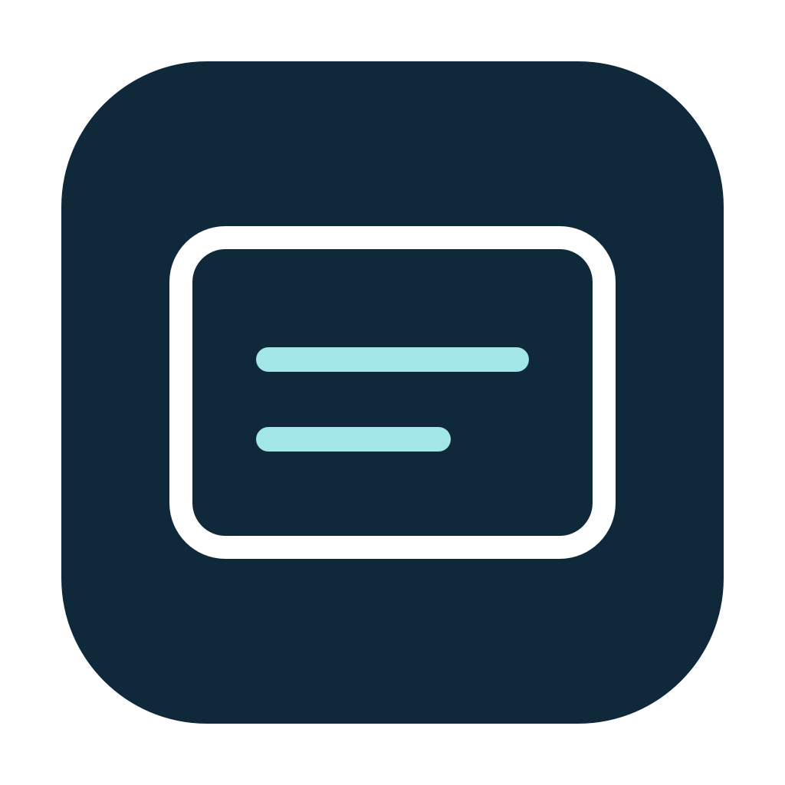

# ReadingGlass



**Read your screen in your language.** ReadingGlass is a native macOS utility that translates text inside a movable, click-through reading glass. Recognition, translation and background refinement run on your Mac.

[Product website](https://chiefinnovator.github.io/readingglass/) · [Preview releases](https://github.com/ChiefInnovator/readingglass/releases) · [Build guide](docs/development.md) · [Report an issue](https://github.com/ChiefInnovator/readingglass/issues)

## Current status

Version 0.1.0 is an early preview. Downloadable preview builds are published on [GitHub Releases](https://github.com/ChiefInnovator/readingglass/releases). These packages are not notarized; macOS may prevent them from opening. You can also build from source. Translation quality, complex layouts and multi-display behavior still need broader real-world validation.

## Features

- Translate screen text in place using local Vision, MLX and Core ML processing.
- Process one frozen snapshot to completion and display its translated image in one update; keep only the newest pending capture.
- Keep interacting with the application beneath the click-through glass.
- Start with a display-relative reading area; adjust width and height independently.
- Automatically widen for clipped or width-limited text, within the selected display.
- Preserve uncertain text and numeric labels; show explicit progress and failures.
- Keep cut-off text unchanged, including near-edge words, until a complete capture is available.
- Match source letter size, text color and top-left position; prefer the original paragraph footprint before limited expansion.
- Hold Original to compare, or open Read full text when a translation cannot fit.
- Control visibility, pause/resume and size reset from the macOS menu bar.
- Copy a full-resolution screenshot of the area behind the glass to the clipboard, even while paused.

## Build and run

Requires an Apple silicon Mac, macOS 15 or later, Xcode with Swift 6.2 or later, and [uv](https://docs.astral.sh/uv/) for the one-time background-model conversion. Python is used during development, not by the running application.

```sh
git clone https://github.com/ChiefInnovator/readingglass.git
cd readingglass
./scripts/build.sh
open .build/DerivedData/Build/Products/Debug/ReadingGlass.app
```

The first build downloads the pinned background-model conversion dependencies. In the app, grant **Screen Recording** permission and install the local translation model (approximately 2.22 GB). Model files are verified before activation.

## Use

1. Move the glass with the toolbar’s hand grip.
2. Choose a target language. Source-language detection is automatic; override it in settings when needed.
3. Use Resize controls to reveal the independent width/height buttons. Hold a button to repeat.
4. Hold the eye button to view the original. Use **Read full text** for output that does not fit safely.
5. Click the camera button or choose **Copy Screenshot** from the menu bar to copy the original UI behind the glass. Paste into ChatGPT, Claude, or another app. ReadingGlass itself and the pointer are excluded; no screenshot file is saved.
6. Use the menu-bar icon to hide/show, pause/resume, reset the size for the current display, or quit.

The initial glass uses 70% of usable display width, capped at 1,400 logical points, and 28% of usable height, capped at 420 points. Retina scale affects capture pixels, not the apparent size of the reading area.

## Privacy

Screen recognition, translation and background refinement run locally. Captured images and recognized text are kept in memory and are not uploaded by the app. Every ReadingGlass window and the pointer are excluded from capture. Model downloads require network access; translation runs locally after installation.

**Copy Screenshot** explicitly puts an image on the system clipboard until replaced. Clipboard managers and other apps may access it. Pasting into another service shares that image with the service you choose.

## Test

```sh
./scripts/test.sh
# Include the installed models and export synthetic visual fixtures:
READINGGLASS_TEST_REAL_MODEL=1 \
READINGGLASS_VALIDATION_DIR="$PWD/.build/validation" ./scripts/test.sh
```

All test fixtures are synthetic. Do not add private screen captures or recognized private text to tests, logs or issues. See [development](docs/development.md) for the architecture and validation boundaries.

## Models and dependencies

ReadingGlass uses a pinned MLX conversion of TranslateGemma and a Core ML conversion of Big LaMa. Model weights are downloaded or prepared separately and are not stored in this repository. Their licenses and notices are separate from the application source; see [third-party notices](Resources/ThirdPartyNotices.md).

## Source license

The source is available under [PolyForm Strict 1.0.0](LICENSE). Read the full terms for permitted uses and restrictions on modification and distribution. This is not an OSI-approved open-source license. Third-party components retain their separate licenses.

## Credits

Created by [Richard Crane](https://inventingfirewith.ai), powered by [MILL5](https://www.mill5.com).

Explore [Inventing Fire with AI](https://inventingfirewith.ai), Richard's podcast on building with AI. [Microsoft MVP profile](https://mvp.microsoft.com/en-US/MVP/profile/10ce0bc0-7536-43f6-b28c-e9601a4a0d0d).

## Releases

Maintainers can build a version-matched preview with `./scripts/package-release.sh v0.1.0`. Pushing a matching `vMAJOR.MINOR.PATCH` tag builds an Apple silicon app and publishes a GitHub prerelease with a ZIP archive, SHA-256 checksum, and versioned release notes. CI packages use ad-hoc signing and are not notarized.
